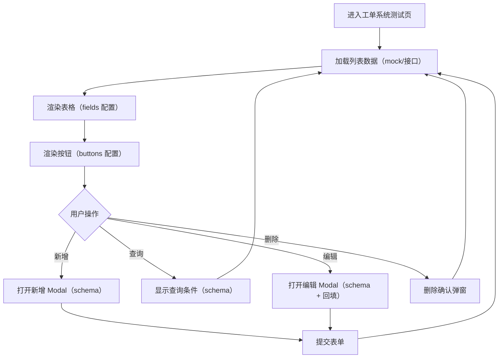

## 1. 产品概述
该项目用于在 Vue 2.6.11 + Ant Design Vue 1.7.2 之上做二次封装，并通过 JSON/Schema 配置快速生成页面，实现「80% 配置 + 20% 插槽」的业务开发模式。
- 目标用户：前端业务开发同学、需要快速搭建 CRUD 页面和表单弹窗的项目
- 产品价值：显著减少重复表单/列表代码，形成统一的字段/按钮/弹窗配置规范

## 2. 核心功能

### 2.1 功能模块
1. **组件二次封装**：Input、Button、Table、Modal 的配置化封装与统一 API
2. **Schema 渲染引擎**：解析 JSON/Schema，渲染页面布局、表格、按钮、弹窗与表单项
3. **工单系统测试页**：左右布局（左菜单右内容），右侧为带 CRUD 的列表页（新增/查询在右上角，编辑/删除在行内最右侧）
4. **配置文件分层**：页面目录下提供 fields 与 buttons 配置文件；新增/编辑使用 modal 配置；表单 input 支持联动规则

### 2.2 页面明细
| 页面名称 | 模块名称 | 功能描述 |
|---|---|---|
| 工单系统测试页 | 左侧菜单 | 展示菜单项，支持切换右侧内容（最小可用为单页） |
| 工单系统测试页 | 列表区（表格） | 读取 fields 配置渲染列；行内提供编辑/删除操作；支持分页与加载态（最小可用可先用本地 mock） |
| 工单系统测试页 | 右上角操作区 | 读取 buttons 配置渲染按钮；新增与查询按钮固定在表格右上角 |
| 工单系统测试页 | 新增/编辑弹窗 | Modal 内渲染表单；表单项来自 schema；支持简单联动（如选择类型影响另一个输入项是否可填/默认值） |

## 3. 核心流程
### 3.1 CRUD 主流程（自然语言）
- 用户进入工单系统测试页，默认展示列表数据
- 用户点击“查询”，展开/弹出查询条件（最小可用可先做成表格右上角内联表单或轻量弹窗）
- 用户点击“新增”，打开新增 Modal，填写表单并提交，列表刷新
- 用户点击某行“编辑”，打开编辑 Modal，回填表单并提交，列表刷新
- 用户点击某行“删除”，二次确认后删除，列表刷新

### 3.2 流程图

## 4. 用户界面设计
### 4.1 设计风格
- 整体：简洁、偏“业务后台”风格，强调信息密度与可读性
- 颜色：以 Ant Design 默认主题为主，辅以少量灰阶背景（内容区卡片化）
- 布局：经典左右结构，内容区域采用卡片 + 表格
- 交互：按钮位置固定规则（新增/查询：右上角；编辑/删除：行内最右侧），减少认知成本

### 4.2 页面设计概览
| 页面名称 | 模块名称 | UI 元素 |
|---|---|---|
| 工单系统测试页 | 左侧菜单 | 可滚动菜单、选中态高亮、顶部系统名 |
| 工单系统测试页 | 右侧内容头部 | 标题、面包屑（可选）、右上角按钮区 |
| 工单系统测试页 | 表格区域 | 表头、字段列、操作列、分页（可选） |
| 工单系统测试页 | 弹窗表单 | 标题、表单项、提交/取消按钮 |

### 4.3 响应式
- 优先桌面端（Desktop-first）
- 内容区表格支持横向滚动以适配窄屏
