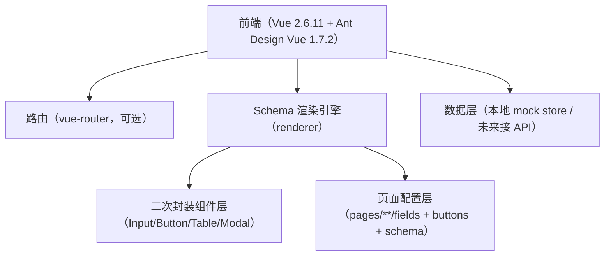

## 1. 架构设计

## 2. 技术说明
- 前端：Vue@2.6.11 + Ant Design Vue@1.7.2
- 构建：Vite（使用 vue-ts 模板，但按 Vue 2 运行环境调整）
- 路由：vue-router（用于演示“左菜单右内容”的多页切换；若先做单页可后续补）
- 数据：本地 mock 数据（数组）+ 简单的 CRUD 操作封装；后续可替换为 API 层

## 3. 路由定义
| 路由 | 用途 |
|---|---|
| / | 默认重定向到测试页 |
| /work-orders | 工单系统测试页（左右布局 + CRUD 列表） |

## 4. 配置与目录约定
### 4.1 目录结构（建议）
- src/
  - components/
    - base/
      - SchemaInput.vue
      - SchemaButton.vue
      - SchemaTable.vue
      - SchemaModal.vue
    - layout/
      - AppLayout.vue
  - renderer/
    - SchemaRenderer.vue
    - schemaTypes.ts
    - resolveComponent.ts
  - pages/
    - work-orders/
      - index.vue
      - fields.ts
      - buttons.ts
      - schemas.ts
      - mock.ts
  - utils/
    - expression.ts
    - deepGetSet.ts

### 4.2 配置分层
- fields.ts：定义表格字段（title、dataIndex、width、customRender/slotKey 等）
- buttons.ts：定义按钮（位置、文案、权限 key、点击行为 action）
- schemas.ts：定义弹窗与表单 schema（字段、校验、联动规则）
- schema 解析：统一由 SchemaRenderer/resolveComponent 映射到 Ant Design Vue 组件二次封装

## 5. Schema 设计要点（“80% 配置 + 20% 插槽”）
### 5.1 覆盖 80% 的配置能力
- 表格：列定义、分页、loading、操作列（编辑/删除）固定规范
- 按钮：位置规范（右上角 topRight，行内 rowRight）、动作规范（openModal、submit、delete、query）
- 弹窗：标题、宽度、form schema、提交/取消按钮
- 表单：Input/Select/DatePicker 等常用输入（先实现 Input 即可，预留扩展点）
- 联动：基于 formModel 与规则表达式（当某字段值变化时，更新另一个字段的 visible/disabled/defaultValue）

### 5.2 预留 20% 插槽扩展
- SchemaTable：允许自定义列渲染插槽（按 columnKey/slotKey 映射）
- SchemaModal：允许自定义 footer/body 插槽
- SchemaRenderer：允许在某些节点通过 slot 覆盖默认渲染

## 6. 数据模型（最小可用）
### 6.1 工单列表数据结构（示例）
- id: string
- code: string（工单号）
- title: string（标题）
- status: string（状态）
- createdAt: string（创建时间）

### 6.2 联动示例（示意）
- 当 status = "关闭" 时，禁用某个输入项（例如“处理人”）
- 当选择某个类型时，自动回填标题前缀
